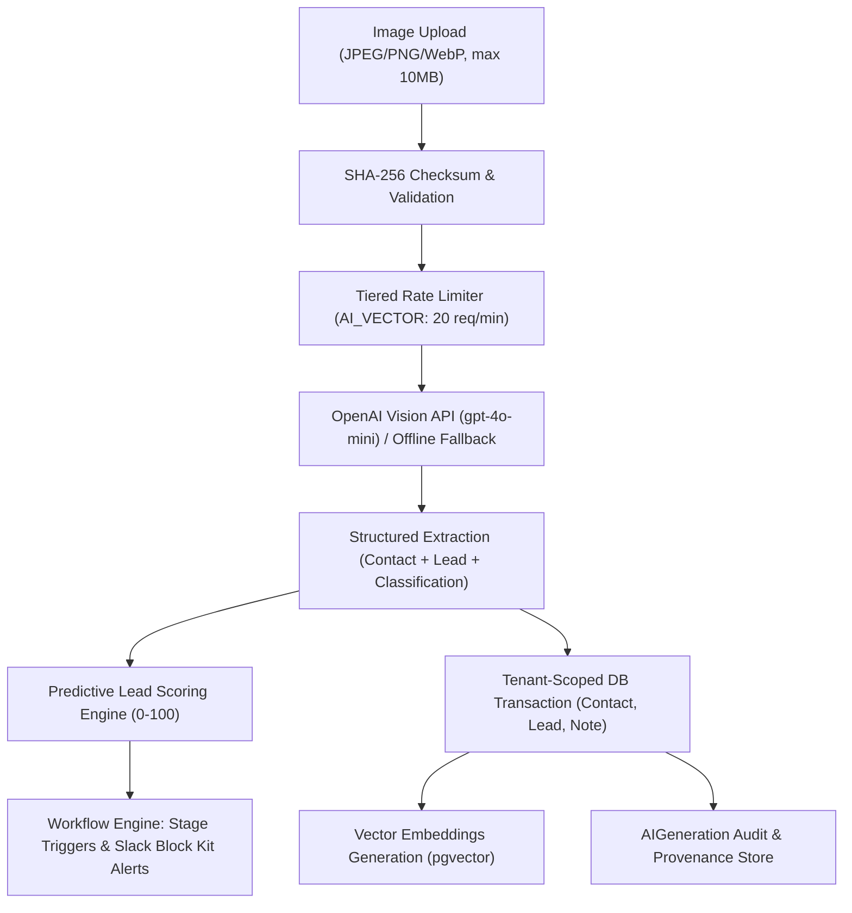

# 📸 Indie CRM: Vision AI & Image Processing Pipeline Guide

Indie CRM features a production-grade, end-to-end **Vision AI Intake Pipeline** designed to convert physical and digital artifacts—such as **business cards, executive whiteboard brainstorms, conference attendee badges, and client intake forms**—into structured, actionable CRM intelligence.

---

## 🏗️ Architecture & Pipeline Flow

The image processing pipeline operates asynchronously with tenant isolation, rate limiting, and AI provenance tracking:



---

## ⚡ Key Pipeline Capabilities

### 1. Multi-Artifact Classification & OCR
The pipeline intelligently detects and categorizes the artifact into specialized schema types:
- **`BUSINESS_CARD`**: Extracts name, job title, company, email, direct phone, and website with high-precision OCR.
- **`WHITEBOARD_NOTE`**: Extracts strategic meeting notes, project scope, budget estimates, and assigns high/urgent priorities.
- **`DOCUMENT_FORM` / `CONFERENCE_BADGE`**: Extracts attendee metadata, conference name, and custom inquiry notes.
- **`RECEIPT_INVOICE`**: Analyzes transactional documents and links vendor/client records.

### 2. Predictive Lead Scoring Integration
Extracted data immediately passes through `src/lib/scoring.ts`:
- Baseline points calculated from stage (`NEW`), priority (`URGENT` / `HIGH`), and confirmed budget indicators.
- Inactive time decay penalty automatically calibrated.
- Generates a numeric score from `0` to `100` displayed directly in the CRM UI and pipeline analytics.

### 3. pgvector Semantic Search Indexing
- The OCR text and AI summary are compiled into a contextual lead note.
- Vector embeddings (`1536-dimensional`) are generated and stored in `NoteEmbedding` for immediate semantic search across historical client memory.

### 4. Automated Workflow Triggers & Slack Block Kit Alerts
- When an extracted lead achieves a high score (e.g. $\ge 70$), the workflow evaluator dispatches an interactive Slack Block Kit webhook containing direct workspace deep-links.

### 5. Audit Logging & AI Provenance
- Every extraction logs an `AuditLogAction.LEAD_CREATED` entry with actor ID, SHA-256 file checksum, and confidence score.
- Raw outputs, prompt version (`v1.0-image-processing`), and token metadata are saved in `AIGeneration`.

---

## 🔌 API Reference

### `POST /api/workspaces/:workspaceSlug/image-workflow`

Ingest an image or execute a demo preset programmatically.

#### Headers
| Header | Type | Description |
|---|---|---|
| `Content-Type` | `multipart/form-data` or `application/json` | Request payload encoding |
| `x-indie-crm-secret` | `string` | Optional webhook/API secret token |

#### Multipart Form Data Parameters
| Parameter | Type | Required | Description |
|---|---|---|---|
| `file` | Binary | Optional* | Image file (JPEG, PNG, WebP $\le$ 10MB) |
| `presetKey` | `string` | Optional* | Demo preset key (`card`, `whiteboard`, `badge`) |

*\*One of `file` or `presetKey` must be provided.*

#### JSON Payload Format (Base64)
```json
{
  "fileName": "client_business_card.png",
  "mimeType": "image/png",
  "base64": "iVBORw0KGgoAAAANSUhEUgAA...",
  "presetKey": null
}
```

#### Example Response (`201 Created`)
```json
{
  "success": true,
  "leadId": "lead_cm8...abc",
  "contactId": "contact_cm8...xyz",
  "noteId": "note_cm8...123",
  "score": 86,
  "extraction": {
    "contact": {
      "name": "Sarah Jenkins",
      "email": "sarah.jenkins@luminarybrand.test",
      "phone": "+1 (555) 839-2041",
      "company": "Luminary Creative Studio",
      "jobTitle": "VP of Brand Strategy",
      "website": "https://luminarybrand.test"
    },
    "lead": {
      "title": "Luminary Creative Studio - Brand Identity Retainer",
      "summary": "Scanned business card: Exploring multi-quarter consulting retainer for brand refresh.",
      "priority": "HIGH",
      "estimatedValue": "$24,000",
      "suggestedTags": ["business-card", "design-systems", "retainer"],
      "nextAction": "Share portfolio deck and schedule 30-min discovery call",
      "followUpDays": 2
    },
    "classification": {
      "imageType": "BUSINESS_CARD",
      "confidence": 0.96,
      "rawOcrText": "LUMINARY CREATIVE STUDIO\nSarah Jenkins | VP Brand Strategy..."
    },
    "metadata": {
      "fileName": "luminary_business_card.jpg",
      "fileSize": 51200,
      "mimeType": "image/jpeg",
      "checksum": "e3b0c44298fc1c149afbf4c8996fb92427ae41e4649b934ca495991b7852b855",
      "provider": "deterministic-fallback",
      "model": "offline-vision-deterministic-v1",
      "processedAt": "2026-09-26T12:00:00.000Z"
    }
  },
  "triggeredActions": [
    {
      "ruleId": "rule_high_score",
      "action": "SEND_SLACK_ALERT",
      "payload": { "webhookUrl": "https://hooks.slack.com/services/..." }
    }
  ]
}
```

---

## 🖥️ Interactive Web UI Demo

Access the interactive scanner inside any workspace:
- URL: `/w/:workspaceSlug/scanner`
- Features:
  - **Drag-and-Drop Dropzone** with file preview.
  - **1-Click Demo Presets**: Test Business Card, Whiteboard Brainstorm, or Conference Badge instantly without local files.
  - **Real-time Pipeline Tracker**: Visual progress across 5 stages (Checksum, OCR, Scoring, Vector Embeddings, Workflow Alerts).
  - **Direct Lead Deep-Link**: Jump directly to the newly generated CRM lead record.

---

## 🛡️ Security & Validation Controls

1. **File Type Filtering**: Enforces strict MIME validation against binary magic bytes and headers (`image/jpeg`, `image/png`, `image/webp`).
2. **Size Quotas**: Strict rejection of payloads $> 10\text{MB}$ or $0\text{-byte}$ empty files.
3. **Multi-Tenant Scoping**: All database queries strictly bind to the authenticated user's `workspace.id` (`tenantId`).
4. **Rate Limiting**: Integrated Redis sliding window limiter enforcing max 20 requests per minute with automatic in-memory fallback.
