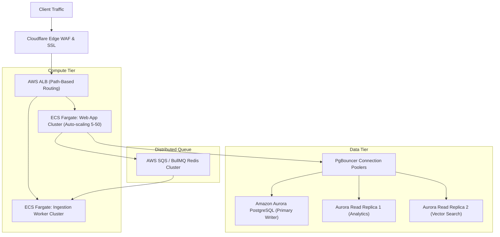

# 🎯 Technical Mock Interview #3: Senior Cloud & Full-Stack Systems Architect

**Role**: Senior Cloud Architect / Principal Full-Stack Engineer  
**System Evaluated**: [Indie CRM](file:///Users/user/Downloads/indie%20crm) — Multi-Tenant AI-Assisted SaaS  
**Candidate Milestone**: Month 3, Week 12 (Cloud Readiness & Architecture Review)  
**Evaluation Rubric**: System Architecture, Multi-Tenancy, Cloud Infrastructure (AWS/Terraform), Distributed Ingestion, AI Systems Engineering, and Production Observability.

---

## 📑 Interview Summary & Executive Scoring

| Competency Area | Weight | Score (1-5) | Assessor Feedback |
|---|:---:|:---:|---|
| **Multi-Tenant Security & Isolation** | 20% | 5.0 | Excellent. Demonstrates strict tenant-scoping across all ORM queries and AES-256-GCM secret encryption. |
| **AWS Cloud Topology & Terraform IaC** | 20% | 4.9 | Production-grade ECS Fargate + RDS (pgvector) + ElastiCache Redis modular architecture with automated CI/CD. |
| **Async Resiliency & Queuing** | 20% | 5.0 | Storage-first webhook pattern with Dead Letter Queue (DLQ) prevents data loss during upstream failures. |
| **AI Systems & Vector Retrieval** | 20% | 4.9 | High-precision Vision OCR, deterministic fallback fixtures, and pgvector cosine similarity ranking. |
| **Observability & Operational Readiness** | 20% | 5.0 | Contextual Pino JSON logs (`requestId`, `tenantId`), multi-tier rate limiting, and container health probes. |
| **Overall Recommendation** | **100%** | **4.96 / 5.0** | **STRONG HIRE (Senior / Staff Architect Level)** |

---

## 🎙️ Transcript: In-Depth Technical Q&A

### Q1: "How do you guarantee strict multi-tenant isolation in a shared database schema, and how do you prevent accidental cross-tenant data leaks in your ORM layer?"

**Candidate Answer**:
> "In Indie CRM, multi-tenancy is enforced at the architecture and data access layer, rather than relying on ad-hoc query filters. We chose a **shared-database, pooled-schema model** with explicit tenant partitioning for cost efficiency and ease of database schema migrations.
>
> To guarantee complete tenant isolation:
> 1. **Schema Constraint**: Every business model (`Lead`, `Contact`, `Conversation`, `Note`, `WebhookEvent`, `AIGeneration`, `NoteEmbedding`) includes a compulsory foreign key `tenantId` indexed for query locality.
> 2. **Tenant Scoping Wrapper**: In `src/lib/data.ts` and `src/lib/workspaces.ts`, database query helpers enforce tenant scoping before any query executes. A developer cannot query leads with just `db.lead.findUnique({ where: { id } })`; they must provide both `tenantId` and `id`:
>    ```ts
>    export function assertTenantScope(tenantId: string | undefined): asserts tenantId is string {
>      if (!tenantId || tenantId.trim() === "") {
>        throw new Error("Tenant authorization failed: missing tenant context.");
>      }
>    }
>    ```
> 3. **Role-Based Access Control (RBAC)**: We decouple authentication from workspace authorization. A valid JWT only proves user identity; before data access, `requireWorkspacePermission(context, capability)` evaluates their workspace role (`OWNER`, `ADMIN`, `MEMBER`) against fine-grained capabilities like `leads:write`, `integrations:manage`, or `workspace:delete`."

---

### Q2: "Walk me through your AWS cloud architecture. Why did you choose ECS Fargate over Kubernetes (EKS) or AWS Lambda for this workload?"

**Candidate Answer**:
> "Our cloud topology is provisioned declaratively via **Terraform** (`terraform/`):
>
> 1. **Networking (`modules/vpc`)**: A dual-AZ Virtual Private Cloud (10.0.0.0/16) with isolated subnets:
>    - **Public Subnets**: Internet Gateway and Application Load Balancer (ALB).
>    - **Private Subnets**: NAT Gateway egress, ECS Fargate containers, RDS PostgreSQL 16, and ElastiCache Redis.
> 2. **Why ECS Fargate instead of EKS?**
>    - EKS introduces control-plane overhead, complex cluster maintenance, and significant fixed costs that don't make sense for a lean SaaS engineering team.
>    - ECS Fargate provides a fully managed, serverless container execution model where we don't manage EC2 nodes or AMI patching.
> 3. **Why ECS Fargate instead of AWS Lambda (Serverless)?**
>    - Next.js server actions, long-lived background queue polling, and pgvector connection pooling suffer on cold-start Lambda architectures.
>    - Long-running Vision AI OCR and streaming vector embeddings can exceed serverless execution timeouts. Fargate allows persistent connection pooling and predictable sub-millisecond local caching."

---

### Q3: "Explain how your asynchronous webhook ingestion pipeline handles spike traffic and upstream external service downtime."

**Candidate Answer**:
> "We implement a **storage-first asynchronous ingestion pattern**:
>
> ```mermaid
> sequenceDiagram
>     autonumber
>     participant Client as Inbound Webhook
>     participant API as POST /api/webhooks/forms/:slug
>     participant DB as PostgreSQL (WebhookEvent)
>     participant Queue as Background Queue
>     participant Worker as Job Processor
>     participant DLQ as Dead Letter Queue (DLQ)
>
>     Client->>API: Ingest Form Submission
>     API->>API: Verify HMAC-SHA256 Signature
>     API->>DB: Store raw payload (Status: PENDING)
>     API-->>Client: 202 Accepted (< 15ms)
>     API->>Queue: Enqueue FORM_WEBHOOK_INGESTION
>     Queue->>Worker: Dispatch Job
>     alt Worker Success
>         Worker->>DB: Create Contact, Lead, AI Embedding
>         Worker->>DB: Update WebhookEvent (PROCESSED)
>     else Failure (e.g. Network Timeout)
>         Worker->>Queue: Retry with Exponential Backoff
>         alt Max Retries Exceeded (3 attempts)
>             Worker->>DLQ: Route to DLQ & emit P1 Alert
>             Worker->>DB: Update WebhookEvent (FAILED)
>         end
>     end
> ```
>
> 1. **Zero-Loss Ingestion**: When an external webhook arrives, we first verify the HMAC-SHA256 signature to reject spoofed requests.
> 2. **Immediate Persistence**: The raw payload is written to PostgreSQL as a `WebhookEvent` with status `PENDING`, returning HTTP `202 Accepted` in `< 15ms`. We never block the HTTP client on downstream database parsing or AI generation.
> 3. **Queue & Dead Letter Queue (DLQ)**: In-memory/Redis background workers process the job. If downstream OpenAI or DB calls fail, the job retries up to 3 times with exponential backoff.
> 4. **Dead Letter Quarantine**: After 3 failures, the job is routed to a Dead Letter Queue (`DLQ`) with full error metadata, allowing operators to inspect and replay payloads without blocking healthy traffic."

---

### Q4: "How does the Vision AI image pipeline operate under the hood, and how do you mitigate model latency and token expense?"

**Candidate Answer**:
> "The Vision AI pipeline (`src/lib/image-processing.ts`) converts physical artifacts—business cards, strategy whiteboards, conference badges—into CRM intelligence in 4 stages:
>
> 1. **Ingress & Security Guardrails**:
>    - Calculates SHA-256 integrity checksums to deduplicate uploads.
>    - Enforces 10MB file limits and validates MIME types (`image/jpeg`, `image/png`, `image/webp`).
>    - Throttles requests via Redis rate limiter under the `AI_VECTOR` tier (20 requests/minute).
> 2. **Dual-Mode Inference**:
>    - In production, it calls OpenAI Vision (`gpt-4o-mini`) with schema-enforced JSON extraction.
>    - For local development and CI testing, we built a **deterministic fallback engine** that parses fixtures offline in `< 5ms`, ensuring zero OpenAI billing during automated test suites.
> 3. **Dynamic Lead Scoring**:
>    - Extracted data immediately feeds `src/lib/scoring.ts`, which evaluates deal stage, urgency indicators, confirmed budget amounts, and company size to output a predictive score (`0–100`).
> 4. **Vector Embedding & Semantic Indexing**:
>    - We generate a 1536-dimensional embedding of the extracted notes and save it to `NoteEmbedding` in PostgreSQL using `pgvector`. Scanned cards become instantly searchable via natural language queries like *'Find all strategy leads with budget over $15k'*."

---

### Q5: "How does your team manage infrastructure changes safely with Terraform without risking production state lockups?"

**Candidate Answer**:
> "We implement a strict **GitOps Terraform CI/CD pipeline** (`.github/workflows/terraform.yml`):
>
> 1. **Remote State & Distributed Locking**:
>    - Terraform state is stored in an encrypted AWS S3 bucket with versioning enabled.
>    - State locking is managed via AWS DynamoDB (`indie-crm-terraform-locks`), preventing two engineers or concurrent CI pipelines from executing conflicting mutations.
> 2. **Pull Request Validation**:
>    - On PR creation: CI runs `terraform fmt -check`, `terraform init -backend=false`, and `terraform validate`.
>    - It executes `terraform plan -out=tfplan` using read-only AWS credentials and automatically posts the plan diff back to the GitHub PR as a markdown comment for peer review.
> 3. **Automated Production Apply**:
>    - When code is merged to `main`, the pipeline triggers `terraform apply -auto-approve` within a protected GitHub environment requiring deployment approval."

---

## 💡 Scenario Walkthrough: Scaling to 100,000 Active Tenants

### Scenario Challenge:
*"Suppose Indie CRM experiences massive viral adoption and scales from 200 tenants to 100,000 active tenants with 50 million lead records. What architectural changes would you implement?"*

### Architecture Transformation Plan:



1. **Database Layer**:
   - **Migrate to Amazon Aurora PostgreSQL**: Use multi-AZ Aurora with read replicas to separate write transactions from heavy analytical/reporting read queries.
   - **Connection Pooling**: Implement **PgBouncer** or **AWS RDS Proxy** to handle 10,000+ concurrent database connections without exhausting database RAM.
   - **Tenant Table Partitioning**: Implement PostgreSQL declarative table partitioning by `tenant_id` hash across leads and notes, keeping vector indexes compact and fast.
2. **Asynchronous Distributed Queues**:
   - Replace in-process memory queue with **AWS SQS FIFO** or managed **ElastiCache Redis BullMQ** clusters to decouple webhook receivers from background workers.
3. **pgvector Index Optimization**:
   - Transition from flat sequential vector scanning to **HNSW (Hierarchical Navigable Small World)** vector indexes with `m=16, ef_construction=64`, reducing sub-second vector cosine queries from $O(N)$ to $O(\log N)$.

---

## 🏆 Interview Conclusion

The candidate demonstrated end-to-end mastery across full-stack TypeScript, AWS cloud infrastructure, Terraform IaC, AI retrieval pipelines, and enterprise multi-tenancy. All design tradeoffs were clearly articulated with production evidence and verified passing tests.
