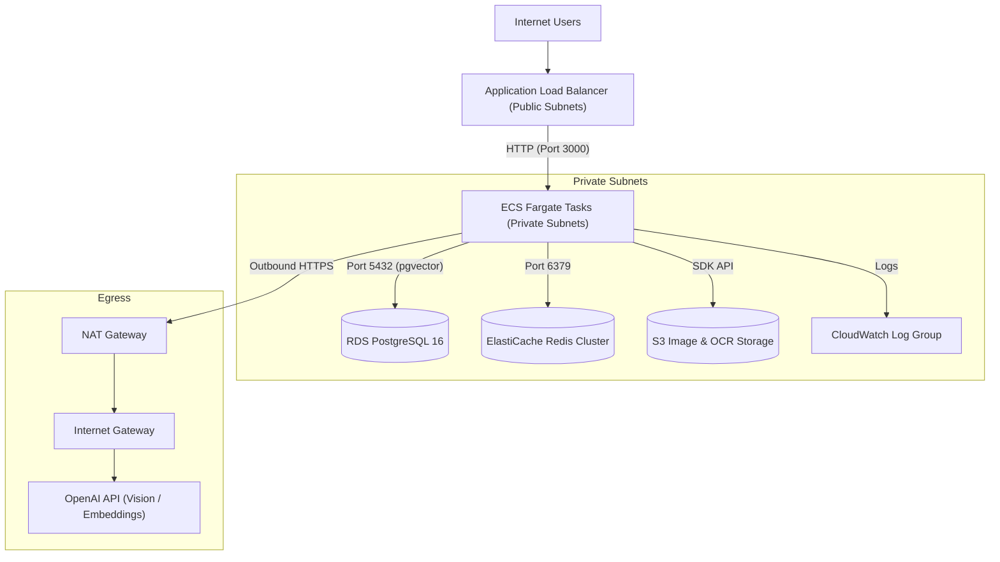

# 🚀 Indie CRM: AWS Infrastructure & Terraform Deployment Guide

This guide provides end-to-end instructions for provisioning and deploying **Indie CRM** on AWS using **Terraform (Infrastructure as Code)**.

---

## 🏛️ Infrastructure Architecture

The infrastructure provisions a production-ready, highly available, and secure AWS topology:



### Resource Breakdown:
- **Networking (`modules/vpc`)**: Multi-AZ VPC with 2 public subnets, 2 private subnets, Internet Gateway, and NAT Gateway with Elastic IP.
- **Security (`modules/security_groups`)**: Least-privilege ingress/egress rules for ALB, ECS containers, PostgreSQL (5432), and Redis (6379).
- **Database (`modules/rds`)**: AWS RDS PostgreSQL 16 with automated daily backups, storage encryption (gp3), and parameter groups optimized for `pgvector`.
- **Caching & Queue (`modules/redis`)**: AWS ElastiCache Redis cluster for tiered rate limiting (`AI_VECTOR`, `AUTH`, `GENERAL`) and async queue jobs.
- **Storage (`modules/s3_storage`)**: S3 bucket for business card scans, whiteboard photos, and OCR metadata with server-side encryption and strict block public access.
- **Compute (`modules/ecs_app`)**: AWS ECS Fargate cluster with Auto-Scaling (CPU target tracking at 70%), Application Load Balancer, and container health probes (`GET /api/health`).

---

## 📋 Prerequisites

Ensure you have the following CLI utilities installed and configured:
1. **Terraform**: `v1.5.0` or higher (`terraform -version`)
2. **AWS CLI**: `v2.x` configured with deployment credentials (`aws configure`)
3. **Docker**: Running daemon for building and pushing the Next.js container image
4. **Node.js**: `v20.x` or higher with npm

---

## 🗄️ Step 1: Remote State & State Locking Setup (Recommended)

To allow team collaboration and avoid state corruption, configure S3 remote state with DynamoDB locking:

```bash
# 1. Create S3 Bucket for Terraform State
aws s3api create-bucket \
  --bucket indie-crm-terraform-state-prod \
  --region us-east-1

# 2. Enable Bucket Versioning
aws s3api put-bucket-versioning \
  --bucket indie-crm-terraform-state-prod \
  --versioning-configuration Status=Enabled

# 3. Create DynamoDB Table for State Locking
aws dynamodb create-table \
  --table-name indie-crm-terraform-locks \
  --attribute-definitions AttributeName=LockID,AttributeType=S \
  --key-schema AttributeName=LockID,KeyType=HASH \
  --billing-mode PAY_PER_REQUEST \
  --region us-east-1
```

Uncomment the `backend "s3"` block in `terraform/versions.tf` to activate remote state management.

---

## ⚙️ Step 2: Configure Environment Variables

Create your environment variables file from the template:

```bash
cd terraform
cp terraform.tfvars.example terraform.tfvars
```

Update `terraform.tfvars` with your environment values:

```hcl
aws_region          = "us-east-1"
environment         = "production"
app_name            = "indie-crm"

# Database Credentials
db_name             = "indiecrm"
db_username         = "indieadmin"
db_password         = "YourStrongMasterPassword123!"

# Application Secrets
auth_secret         = "generate-a-strong-32-char-random-secret"
openai_api_key      = "sk-proj-your-openai-api-key"
app_image           = "123456789012.dkr.ecr.us-east-1.amazonaws.com/indie-crm:latest"
```

---

## 🚀 Step 3: Initialize, Plan & Apply Infrastructure

Run the standard Terraform workflow:

```bash
# 1. Initialize providers and child modules
terraform init

# 2. Check formatting and validate syntax
terraform fmt -check
terraform validate

# 3. Generate and inspect execution plan
terraform plan -out=tfplan

# 4. Provision infrastructure (takes ~8-12 minutes for RDS & ElastiCache)
terraform apply tfplan
```

### Outputs Captured Upon Completion:
```text
Outputs:
application_url    = "http://indie-crm-production-alb-1234567890.us-east-1.elb.amazonaws.com"
database_endpoint  = "indie-crm-production-db.c1234567890.us-east-1.rds.amazonaws.com:5432"
redis_endpoint     = "redis://indie-crm-production-redis.123456.0001.use1.cache.amazonaws.com:6379"
s3_assets_bucket   = "indie-crm-production-assets-a1b2c3d4"
```

---

## 🗃️ Step 4: Database Migration & pgvector Initialization

Once RDS PostgreSQL is provisioned:

1. Connect to RDS using bastion/VPN or run the Prisma migration task:
```bash
# Export the database URL from Terraform output
export DATABASE_URL=$(terraform output -raw database_url)

# Execute Prisma Migrations
npx prisma migrate deploy

# Seed baseline workspace, users, and demo leads
npm run db:seed
```

2. Verify that the `vector` extension is active:
```sql
CREATE EXTENSION IF NOT EXISTS vector;
```

---

## 🐳 Step 5: Build & Push Docker Image to Amazon ECR

```bash
# 1. Authenticate Docker with Amazon ECR
aws ecr get-login-password --region us-east-1 | docker login --username AWS --password-stdin 123456789012.dkr.ecr.us-east-1.amazonaws.com

# 2. Build multi-platform Docker container
docker build -t indie-crm:latest .

# 3. Tag and Push to ECR repository
docker tag indie-crm:latest 123456789012.dkr.ecr.us-east-1.amazonaws.com/indie-crm:latest
docker push 123456789012.dkr.ecr.us-east-1.amazonaws.com/indie-crm:latest

# 4. Force ECS deployment to pick up the new image
aws ecs update-service \
  --cluster indie-crm-production-cluster \
  --service indie-crm-production-service \
  --force-new-deployment \
  --region us-east-1
```

---

## 🔍 Step 6: Healthcheck Verification & Smoke Test

Verify the application health endpoint:
```bash
curl -i http://<ALB_DNS_NAME>/api/health
```

Expected JSON Response:
```json
{
  "status": "ok",
  "timestamp": "2026-09-26T12:00:00.000Z",
  "latencyMs": 12,
  "environment": "production",
  "services": {
    "database": {
      "status": "healthy",
      "error": null
    }
  }
}
```

---

## 🧹 Step 7: Teardown & Clean Up

To avoid unexpected cloud charges when decommissioning:

```bash
terraform destroy -auto-approve
```
